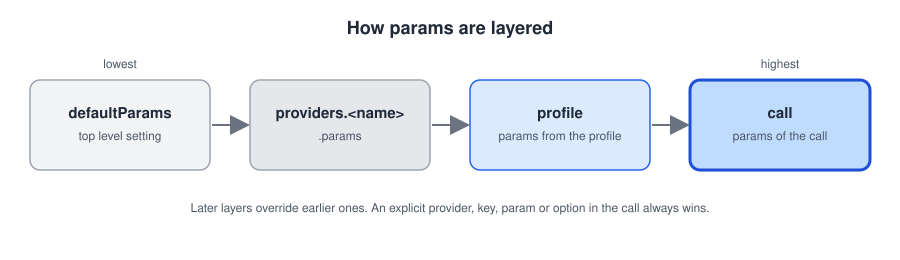
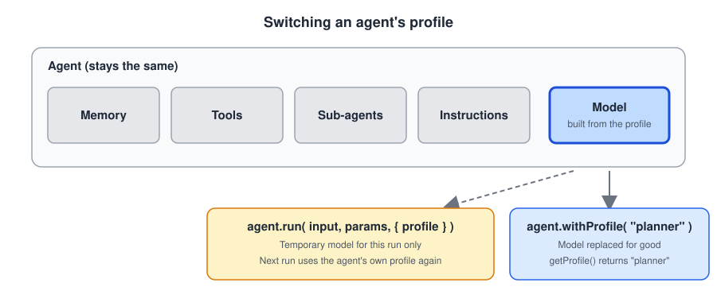
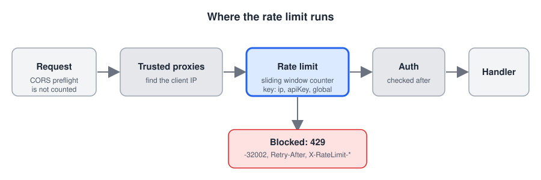

# 3.7.0 Release Notes

**Released:** Unreleased (in development)

BoxLang AI 3.7.0 adds **profiles**: name a combination of provider, model, params, options and API key once (`fast`, `planner`), then pick it by name for a call, for an agent, or for a single agent run. It gives chat UIs what they need to list profiles and switch between them, without ever returning an API key.

It also gives `aiEmbed()` its own default provider and model, so embeddings no longer depend on your chat provider, and it fixes Mistral text-to-speech rejecting a voice name.

> This page is updated as new items land on `development`.

<!-- TODO before release: confirm the version number, and add the MiniMax default model change if it lands (the default MiniMax-M2.5-highspeed is no longer served by MiniMax). -->

---

## ⚠️ Migration

* **MCP servers no longer trust forwarded headers by default.** `X-Forwarded-For` and similar headers were read from anyone, so a client could pick its own IP. Now the client IP is the connection address unless you set your proxies with `withTrustedProxies( [ "10.0.0.0/8" ] )` or `mcp.server.trustedProxies`. `[ "*" ]` restores the old behavior. A server behind a proxy that uses `withAllowedIPs()` must set its trusted proxies. See [Trusted Proxies](../../mcp/server/server-configuration.md#trusted-proxies).
* Without a `profiles` setting nothing else changes.

---

## ✨ New Features

### 🧩 Profiles

A profile is a named combination of provider, model, params, options and API key. Set them in `boxlang.json`:

```json
"profiles": {
  "fast": {
    "description": "Cheap and quick, for small tasks",
    "provider": "openai",
    "model": "gpt-4.1-mini",
    "params": { "temperature": 0 },
    "apiKeyEnv": "OPENAI_API_KEY"
  },
  "planner": {
    "description": "Slower and smarter, for planning",
    "provider": "claude",
    "model": "claude-opus-5-5",
    "params": { "max_tokens": 8192 },
    "apiKeyEnv": "CLAUDE_API_KEY"
  }
},
"defaultProfile": ""
```

Then pick one:

```javascript
aiChat( "Summarize this", {}, { profile: "fast" } )
model   = aiModel( profile: "fast" )
agent   = aiAgent( name: "support", profile: "fast" )

agent.run( "Plan the migration", {}, { profile: "planner" } )  // this run only, same memory
agent.withProfile( "planner" )                                 // switch for good
```

| Where | How |
|---|---|
| `aiChat()`, `aiChatStream()`, `aiEmbed()` | `options: { profile: "fast" }` |
| `aiService()`, `aiModel()`, `aiAgent()` | `profile: "fast"` |
| One agent run | `agent.run( input, params, { profile: "planner" } )`, also `stream()` |
| An agent, for good | `agent.withProfile( "planner" )`, then `agent.getProfile()` |

* Params layer as `defaultParams`, then `providers.<name>.params`, then the profile, then the params of the call. An explicit provider, key, param or option in the call always wins.



* The profile `default` always exists. It is your top level `provider`, `apiKey` and `defaultParams`. `defaultProfile` names another profile to use when a call names no provider.
* Changing an agent's profile replaces its model. Memory, tools, sub-agents, instructions, the agent's own params and options, and the middleware, skills and MCP servers of the model stay. `setModel()` sets the agent's profile to the one of its new model.
* A profile's params (including its model) and options only reach its own provider, like its key.



* A sub-agent has its own profile, set when you create it with `aiAgent( profile: )`. A profile passed to a run applies to that agent only.
* The module checks the settings when it starts: a profile cannot be named like a provider or `default`, names use letters, numbers, `_` and `-`, and `defaultProfile` must exist (`InvalidConfiguration`). An unknown profile in a call throws `ProfileNotFound`.

#### Listing profiles

For chat UIs and remote control (a `/profile` or `/provider` command):

| BIF | Returns |
|---|---|
| `aiProfiles()` | Every profile, the default first: `name`, `description`, `provider`, `model`, `params`, `options`, `apiKeyEnv`, `hasApiKey`, `isDefault` |
| `aiProfile( name )` | One of those |
| `aiProviders()` | `name`, `isDefault`, `hasApiKey` for each provider |

Nothing returns an API key. Params and options that look like secrets show as `****`. A new `onAIProfileSwitch` event fires with `{ agent, from, to, scope }` when an agent changes profile.

#### Keys stay secret

* Prefer `apiKeyEnv`, the name of the environment variable, to a literal `apiKey`.
* A profile key is only sent to the profile's own provider. The global `apiKey` is no longer sent to a different provider when a profile selects one.
* `profiles` is removed from request options, so it cannot reach logs or events.

### 🔢 Embeddings Defaults

`aiEmbed()` used your chat provider, which fails when that provider has no embeddings. The new `embeddings` setting gives it its own default:

```json
"embeddings": { "defaultProvider": "openai", "defaultModel": "text-embedding-3-small", "defaultApiKey": "" }
```

The order of priority is the call, then `options.profile`, then the `embeddings` setting, then `defaultProfile` (its provider, key and options only), then the default provider. The global `apiKey` still applies when the embeddings provider is the global provider. Empty values keep the old behavior.

### 🚦 MCP Server Rate Limiting

Limit how often one client can call an MCP server you build with `mcpServer()`:

```javascript
mcpServer( "myApp" )
    .withTrustedProxies( [ "10.0.0.0/8" ] )
    .withRateLimit( { limit: 100, window: 60, key: "ip", cacheName: "mcpLimits" } )
```



* One sliding window counter, checked **before** authentication. A CORS preflight is not counted.
* `key` is `"ip"` (default), `"apiKey"` (only keys your provider accepts, and a new key is counted on the IP before your provider is asked, so a flood of fake keys never reaches it), `"global"`, or a lambda. Keys are hashed in stores.
* Blocked requests get `429`, JSON-RPC `-32002`, `Retry-After` and `X-RateLimit-*` headers. A store failure lets requests through, or answers `503` with `failOpen: false`.
* Counters live in a BoxLang cache by default, or `"memory"`, or your own `IRateLimitStore`.
* Nothing is logged on the request path, so a flood cannot fill your logs. The new `onMCPRateLimitHit` event fires at most 10 times a minute per server. Stats have `security.rateLimitFailures` and a `rateLimit` section with exact totals.
* `withTrustedProxies()` and the `mcp.server.trustedProxies` setting: forwarded headers are only honored from your proxies. Empty (the default) never trusts them, `[ "*" ]` trusts them from anyone (see Migration).
* New `mcp.server.rateLimit` settings give defaults for every server. Off by default.
* **Several limits** per server (`limits: [ { limit: 60, window: 60 }, { limit: 1000, window: 3600 } ]`), `disableRateLimit()` and `enableRateLimit()`, `resetRateLimit()` and `resetRateLimitStats()`.
* **History and reports**: per client and day, kept in the cache for `retentionDays` (default 7). `getRateLimitReport( { days, top } )` returns the days and the top consumers with `peakPerMinute` and `pctOfLimit`. Settings `historyFlushSeconds` (30) and `historyMaxClients` (500) bound the cost.

See [Rate Limiting](../../mcp/server/rate-limiting.md).

---

## 🪲 Fixed

* **OpenAI images**: `gpt-image-1` was shut down by OpenAI on 2026-10-23, so `aiImage()` with OpenAI failed with `The model 'gpt-image-1' does not exist`. The default is now `gpt-image-2.5-flare`. Use `model: "gpt-image-2.5-sunburst"` for OpenAI's most capable image model. See [Generating Images](../../main-components/image-generation/generating.md#openai).
* **Cache timeouts**: BoxLang cache timeouts are in seconds, but the HITL `CacheDecisionStore` and `CacheMemory.saveState()` passed minutes, so grants and checkpoints expired 60 times too early.
* **MCP client IPs**: a port was never removed from `192.168.1.1:8080` and the IPv6 address `::1` became `1`. Bracketed IPv6 (`[::1]:8080`) works too.

* **Mistral** text-to-speech failed with `voice is not supported for speech v1` (HTTP 400, code 3051) when a voice name (or the voice of another provider, such as OpenAI's `nova`) reached it. Mistral only has `voice_id`, so `voice` is translated: a UUID is sent as `voice_id`, the name of one of your Mistral voices is looked up in your Mistral voices and its id is sent, and a name with no match falls back to the first preset voice. The default model is now Voxtral TTS 3 (`voxtral-mini-tts-3-0`), since `voxtral-mini-tts-2603` is deprecated and retires on 2027-04-30.

---

## 🧰 Project

* `MockService` records the other params of each request (`temperature`, `max_tokens`, ...) in `getRecorded()` as `params`, so tests can check what reached the provider.
* The live MiniMax tests only run with `AI_TESTS_MINIMAX=true`.
* The `Release` workflow can be run by hand from `development` or `main` with a `snapshot` input. It never runs the tests.

---

## 📖 Documentation

* [Rate Limiting](../../mcp/server/rate-limiting.md), new, and trusted proxies in [Server Configuration](../../mcp/server/server-configuration.md)
* [Profiles](../../main-components/profiles.md), new
* [Configuration](../../getting-started/configuration.md), new, and a shorter [Installation](../../getting-started/installation/README.md)
* [aiProfile](../../advanced/reference/built-in-functions/aiprofile.md), [aiProfiles](../../advanced/reference/built-in-functions/aiprofiles.md) and [aiProviders](../../advanced/reference/built-in-functions/aiproviders.md), new
* The `profile` option in [aiChat](../../advanced/reference/built-in-functions/aichat.md), [aiChatStream](../../advanced/reference/built-in-functions/aichatstream.md), [aiEmbed](../../advanced/reference/built-in-functions/aiembed.md), [aiModel](../../advanced/reference/built-in-functions/aimodel.md), [aiAgent](../../advanced/reference/built-in-functions/aiagent.md) and [aiService](../../advanced/reference/built-in-functions/aiservice.md)
* [Embeddings](../../rag/embeddings.md), [Agents](../../main-components/agents/getting-started.md), [Sub-Agents & Hierarchy](../../main-components/agents/hierarchy.md) and [Security](../../deployment/security.md)
* [Events](../../advanced/events.md#70-onaiprofileswitch)
* The `bx-ai-profiles` skill in [ortus-boxlang/skills](https://github.com/ortus-boxlang/skills) covers profiles for AI coding agents
